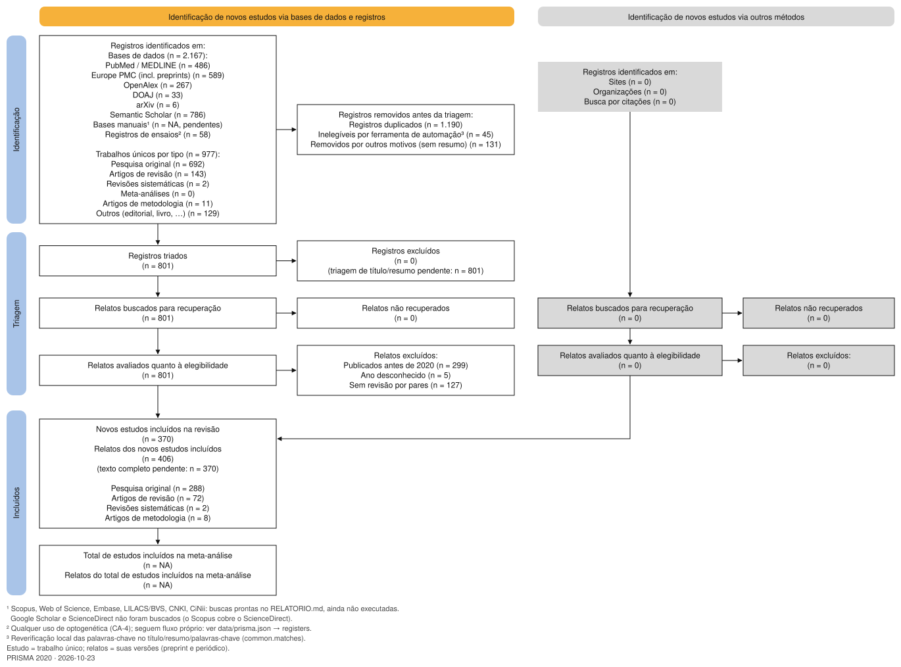
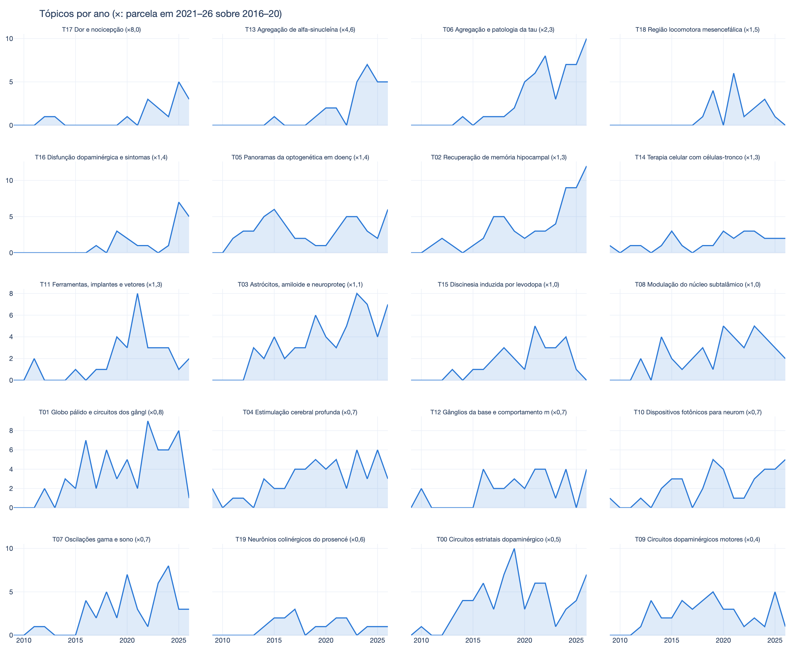
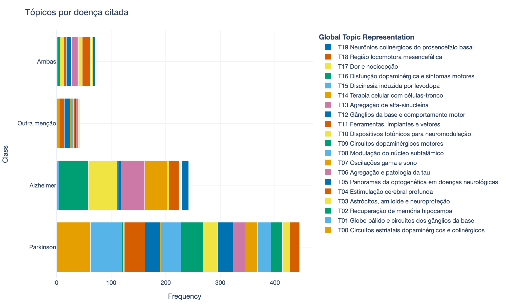
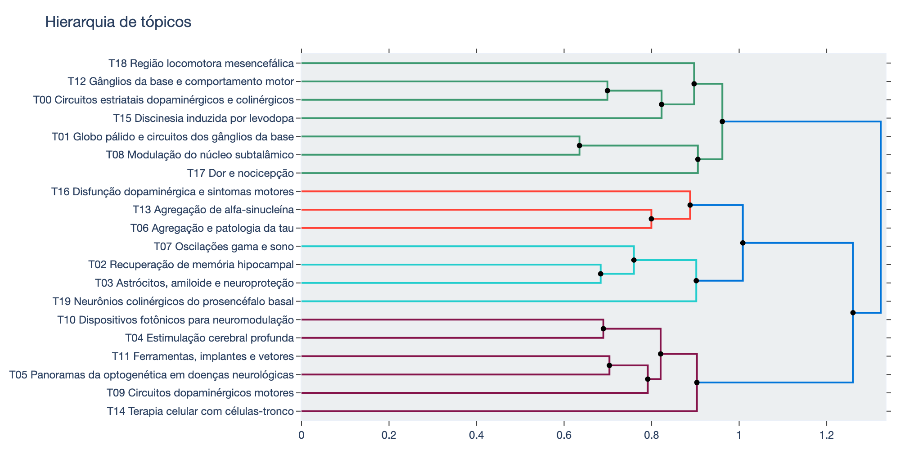
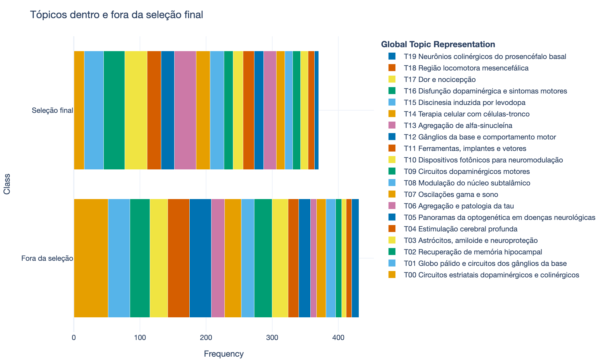

# Optogenética × Alzheimer/Parkinson: relatório da busca

_Gerado por `python3 -m litreview.report`. Buscas executadas em 2026-10-23 (última em 2026-10-23T13:47:30). Protocolo: [PROTOCOLO.md](PROTOCOLO.md)._

## Números principais

- **2.167** registros coletados em **6** bases consultadas por código
- **977** trabalhos únicos depois da deduplicação entre bases (1.190 registros duplicados removidos)
- **801 trabalhos únicos atendem à regra de inclusão** (palavras-chave reconferidas no título, resumo e palavras-chave); 131 não verificáveis (sem resumo) e 45 rejeitados como falsos positivos dos buscadores
- Registros de ensaios clínicos: **58** registros → **18** sobre optogenética → **11 ensaios optogenéticos de tratamento distintos**, **0 em Alzheimer ou Parkinson**

## Critérios de aceitação

| CA | Critério | Situação |
|---|---|---|
| CA-1 | Lista de bases pesquisáveis, consultadas por código sempre que possível | ✅ 6 bases de literatura e 5 registros de ensaios consultados por API; 6 bases licenciadas ou só web documentadas com buscas prontas |
| CA-2 | Busca quantitativa, com método explicado (optogenética E (alzheimer OU parkinson), em vários idiomas) | ✅ busca exata e número de resultados por base abaixo e em `data/search_log.json` |
| CA-3 | Contagem por base, exclusivos de cada base, total sem repetição, fácil de somar | ✅ `data/counts.csv`, `data/overlap_matrix.csv`, `data/works.csv` (coluna 0/1 por base) |
| CA-4 | Busca sistemática em registros de ensaios clínicos para qualquer uso de optogenética | ⚠️ parcial: um registro falhou na execução (ver tabela; o WHO ICTRP cobre ChiCTR, JPRN, ANZCTR, ReBEC, CTRI e DRKS); precisa ser refeito ou exportado manualmente. Decisões de triagem em `data/trials.csv` |

## Literatura: resultados por base

*Resultados* (`api_hits`) = número informado pela API da base; *Confirmados* (`confirmed`) = trabalhos cujo título/resumo/palavras-chave de fato contêm os dois conceitos; *Exclusivos* (`unique_confirmed`) = trabalhos confirmados encontrados **só** naquela base; *Participação* (`share_of_total_confirmed`) = fração de todos os trabalhos únicos confirmados coberta pela base.

| Base | Resultados | Coletados | Confirmados | Não verificáveis | Rejeitados | Exclusivos | Participação |
|---|---|---|---|---|---|---|---|
| PubMed / MEDLINE | 486 | 486 | 477 | 0 | 0 | 5 | 59,6% |
| Europe PMC (incl. preprints) | 589 | 589 | 535 | 0 | 21 | 18 | 66,8% |
| OpenAlex | 267 | 267 | 230 | 4 | 24 | 69 | 28,7% |
| Semantic Scholar | 786 | 786 | 637 | 128 | 0 | 138 | 79,5% |
| DOAJ | 33 | 33 | 33 | 0 | 0 | 2 | 4,1% |
| arXiv | 6 | 6 | 6 | 0 | 0 | 0 | 0,7% |
| TOTAL (sem repetição) | 2.167 | 2.167 | 801 | 131 | 45 |  | 100,0% |

As versões preprint e de periódico do mesmo estudo contam como um só trabalho (49 trabalhos confirmados unem mais de 1 DOI; ver `n_versions`).

### Matriz de sobreposição (trabalhos confirmados presentes nas duas bases)

|  | pubmed | epmc | openalex | s2 | doaj | arxiv |
|---|---|---|---|---|---|---|
| pubmed | 477 | 471 | 103 | 403 | 29 | 3 |
| epmc | 471 | 535 | 112 | 448 | 29 | 3 |
| openalex | 103 | 112 | 230 | 151 | 23 | 1 |
| s2 | 403 | 448 | 151 | 637 | 30 | 6 |
| doaj | 29 | 29 | 23 | 30 | 33 | 0 |
| arxiv | 3 | 3 | 1 | 6 | 0 | 6 |

## Fluxo PRISMA 2020 e seleção final

Gerado por `python3 -m litreview.prisma`, que segue o modelo do PRISMA 2020 para revisões novas com bases, registros e outras fontes. Diagrama: `data/prisma_flow.svg` (inglês: `data/prisma_flow.en.svg`); todos os n: `data/prisma.json`; etapa em que cada trabalho saiu do fluxo: `data/prisma_works.csv`; **seleção final: `data/included.csv`**.



| Etapa | Passo | n |
|---|---|---|
| Identificação | Registros identificados nas bases | 2.167 |
|  | Duplicados removidos | 1.190 |
|  | Inelegíveis pela reverificação automática de palavras-chave | 45 |
|  | Removidos por outros motivos (sem resumo em nenhuma fonte) | 131 |
| Triagem | Registros triados (título/resumo) | 801 |
|  | Excluídos na triagem de título/resumo | 0 |
|  | Relatos buscados para recuperação | 801 |
|  | Relatos não recuperados | 0 |
| Elegibilidade | Relatos avaliados quanto à elegibilidade | 801 |
|  | Excluídos: publicados antes de 2020 | 299 |
|  | Excluídos: ano desconhecido | 5 |
|  | Excluídos: sem revisão por pares | 127 |
| Incluídos | **Novos estudos incluídos na revisão** | **370** |
|  | Relatos (versões) desses estudos | 406 |

Critérios de elegibilidade, aplicados nesta ordem (cada trabalho é contado uma vez, pelo primeiro critério que não cumpre): (1) publicado em 2020 ou depois; (2) com revisão por pares (`peer_reviewed: true`, artigo de periódico ou revisão). 87 trabalhos falham nos dois.

Seleção final por tipo de estudo: pesquisa original: 288, revisão: 72, revisão sistemática: 2, metodologia: 8. Por ano: 2020: 45, 2021: 48, 2022: 49, 2023: 52, 2024: 65, 2025: 60, 2026: 51.

**Atenção:** a triagem humana ainda não começou (801 pendentes na triagem de título/resumo, 370 na leitura do texto completo). Os 370 incluídos são os que passam nos critérios automáticos. As decisões dos revisores são lidas dos campos `prisma.screening` de `articles/*.md` e atualizam o fluxo na próxima execução.

Diferenças em relação ao modelo: Google Scholar e ScienceDirect não foram buscados (o Google Scholar não é reprodutível e o ScienceDirect é coberto pelo Scopus); as bases manuais (Scopus, Web of Science, Embase, LILACS/BVS, CNKI, CiNii) e a busca por citações ainda não foram feitas (n = 0 em "outros métodos"). A classificação por tipo de estudo é heurística (tipos de publicação do PubMed/Europe PMC, título e veículo; `study_type` no cabeçalho de cada artigo).

Registros de ensaios (fluxo próprio, qualquer uso de optogenética): 58 registros triados → 40 excluídos → 18 incluídos → 5 registros duplicados do mesmo ensaio → **13 ensaios distintos**, 0 em DA/DP.

Trabalhos confirmados por ano: 2009: 4, 2010: 3, 2011: 8, 2012: 15, 2013: 15, 2014: 28, 2015: 34, 2016: 44, 2017: 36, 2018: 50, 2019: 62, 2020: 58, 2021: 69, 2022: 64, 2023: 68, 2024: 81, 2025: 78, 2026: 79

### Buscas executadas (texto exato)

**PubMed / MEDLINE** — ok, executada em 2026-10-23T13:47:30

```
(optogenet*[tiab] OR optogenet*[ot] OR opto-genet*[tiab] OR opto-genet*[ot] OR optigenet*[tiab] OR optigenet*[ot]) AND (alzheimer*[tiab] OR alzheimer*[ot] OR parkinson*[tiab] OR parkinson*[ot])
```
- sensibilidade — busca só com MeSH: `"Optogenetics"[Mesh] AND ("Alzheimer Disease"[Mesh] OR "Parkinson Disease"[Mesh] OR "Parkinsonian Disorders"[Mesh])` → 111 resultados

**Europe PMC (incl. preprints)** — ok, executada em 2026-10-23T13:47:30

```
(TITLE_ABS:optogenet* OR KW:optogenet* OR TITLE_ABS:"opto-genet*" OR KW:"opto-genet*" OR TITLE_ABS:optigenet* OR KW:optigenet*) AND (TITLE_ABS:alzheimer* OR KW:alzheimer* OR TITLE_ABS:parkinson* OR KW:parkinson*)
```
- sensibilidade — todos os campos, incluindo texto completo: `(optogenet* OR "opto-genet*" OR optigenet*) AND (alzheimer* OR parkinson*)` → 9.495 resultados

**OpenAlex** — ok, executada em 2026-10-23T13:47:30

```
title_and_abstract.search, union of: [(optogenetic OR optogenetics) AND (alzheimer OR parkinson OR parkinsonism OR parkinsonian)] ∪ [(optogenetically OR "opto-genetic") AND (alzheimer OR parkinson OR parkinsonism OR parkinsonian)] ∪ [("opto-genetics" OR optigenetic) AND (alzheimer OR parkinson OR parkinsonism OR parkinsonian)] ∪ [(optigenetics OR optogenética) AND (alzheimer OR parkinson OR parkinsonism OR parkinsonian)] ∪ [(optogenético OR optogenetica) AND (alzheimer OR parkinson OR parkinsonism OR parkinsonian)] ∪ [(optogenetico OR optogénétique) AND (alzheimer OR parkinson OR parkinsonism OR parkinsonian)] ∪ [(optogenetique OR optogenetik) AND (alzheimer OR parkinson OR parkinsonism OR parkinsonian)] ∪ [(optogenetisch) AND (alzheimer OR parkinson OR parkinsonism OR parkinsonian)] ∪ [(光遗传 OR 光遺傳) AND (阿尔茨海默 OR 阿茲海默 OR 阿兹海默 OR 帕金森)] ∪ [(光遗传 OR 光遺傳) AND (alzheimer OR parkinson OR parkinsonism OR parkinsonian)] ∪ [(光遺伝 OR オプトジェネティクス) AND (アルツハイマー OR パーキンソン)] ∪ [(光遺伝 OR オプトジェネティクス) AND (alzheimer OR parkinson OR parkinsonism OR parkinsonian)] ∪ [(оптогенетика OR оптогенетический) AND (альцгеймер OR паркинсон)] ∪ [(оптогенетика OR оптогенетический) AND (alzheimer OR parkinson OR parkinsonism OR parkinsonian)] ∪ [(광유전) AND (알츠하이머 OR 파킨슨)] ∪ [(광유전) AND (alzheimer OR parkinson OR parkinsonism OR parkinsonian)]
```

**DOAJ** — ok, executada em 2026-10-23T13:47:30

```
(bibjson.title:(optogenetic OR optogenetics OR optogenetically OR "opto-genetic" OR "opto-genetics" OR optigenetic OR optigenetics OR optogenética OR optogenético OR optogenetica OR optogenetico OR optogénétique OR optogenetique OR optogenetik OR optogenetisch) OR bibjson.abstract:(optogenetic OR optogenetics OR optogenetically OR "opto-genetic" OR "opto-genetics" OR optigenetic OR optigenetics OR optogenética OR optogenético OR optogenetica OR optogenetico OR optogénétique OR optogenetique OR optogenetik OR optogenetisch) OR bibjson.keywords:(optogenetic OR optogenetics OR optogenetically OR "opto-genetic" OR "opto-genetics" OR optigenetic OR optigenetics OR optogenética OR optogenético OR optogenetica OR optogenetico OR optogénétique OR optogenetique OR optogenetik OR optogenetisch)) AND (bibjson.title:(alzheimer OR parkinson OR alzheimers OR parkinsons OR parkinsonism OR parkinsonian) OR bibjson.abstract:(alzheimer OR parkinson OR alzheimers OR parkinsons OR parkinsonism OR parkinsonian) OR bibjson.keywords:(alzheimer OR parkinson OR alzheimers OR parkinsons OR parkinsonism OR parkinsonian))
```

**arXiv** — ok, executada em 2026-10-23T13:47:30

```
(ti:optogenet* OR abs:optogenet* OR ti:optigenet* OR abs:optigenet*) AND (ti:alzheimer* OR abs:alzheimer* OR ti:parkinson* OR abs:parkinson*)
```

**Semantic Scholar** — ok, executada em 2026-10-23T13:47:30

```
(optogenet* | "opto-genet*" | optigenet*) + (alzheimer* | parkinson*)
```

### Bases não consultadas por código (licença / bloqueio a robôs)

Faça estas buscas manualmente, exporte os resultados em RIS/CSV para `data/manual/` e inclua-os na deduplicação (ver README).

| Base | Acesso | Busca |
|---|---|---|
| Scopus | API Elsevier (chave institucional) | `TITLE-ABS-KEY(optogenet* OR "opto-genet*" OR optigenet*) AND TITLE-ABS-KEY(alzheimer* OR parkinson*)` |
| Web of Science Core Collection | API WoS Starter/Expanded (chave Clarivate) | `TS=(optogenet* OR "opto-genet*" OR optigenet*) AND TS=(alzheimer* OR parkinson*)` |
| Embase | Ovid/Elsevier (licença; sem API aberta) | `(optogenet* OR 'opto-genet*' OR optigenet*):ti,ab,kw AND (alzheimer* OR parkinson*):ti,ab,kw` |
| LILACS / BVS (pt/es) | Só web (bloqueio a robôs; exportar CSV) | `(tw:(optogenet* OR optogenétic* OR optogenétic*)) AND (tw:(alzheimer* OR parkinson*))` |
| CNKI (zh) | Só web (licença) | `SU=('光遗传'+'光遺傳') AND SU=('阿尔茨海默'+'帕金森')` |
| CiNii / J-STAGE (ja) | API OpenSearch do CiNii (gratuita) | `光遺伝 OR オプトジェネティクス AND (アルツハイマー OR パーキンソン)` |

## Base de artigos e revisão por pares

`articles/` tem um arquivo Markdown para cada trabalho confirmado (801): cabeçalho YAML (título, DOI, autores, identificadores, trilha de identificação PRISMA e campos de triagem ainda vazios) e o resumo como corpo. A seleção final do fluxo PRISMA fica em `articles/selected/`; os demais ficam direto em `articles/`. Índice: `data/articles_index.csv`. 761 têm resumo e 750 têm DOI.

**582 dos 801 trabalhos (73%) passaram por revisão por pares** (`peer_reviewed: true`).

| Tipo de documento | Trabalhos | `peer_reviewed` |
|---|---|---|
| Artigo de periódico | 456 | true |
| Revisão | 126 | true |
| Preprint | 82 | false |
| Tese / dissertação | 44 | false |
| Resumo de congresso (suplemento de periódico) | 33 | false |
| Trabalho completo de congresso | 22 | false |
| Tipo desconhecido | 16 | false |
| Editorial / notícia / comentário | 10 | false |
| Livro ou capítulo | 8 | false |
| Outros (dataset, relatório) | 4 | false |

Como é decidido: nenhuma base informa diretamente se houve revisão por pares, então isso é inferido do tipo de publicação e do veículo.

- A ordem de confiança é PubMed > Europe PMC > DOAJ (só lista periódicos com revisão por pares) > OpenAlex (consultado pelo DOI) > Semantic Scholar. A evidência usada para cada trabalho fica no campo `peer_review_basis`.
- O trabalho conta como revisado se qualquer versão dele saiu em periódico como artigo ou revisão. Um preprint unido à versão publicada é, portanto, `true`.
- Preprints são reconhecidos pelo prefixo do DOI ou pelo nome do servidor (bioRxiv, incluindo `10.64898`, medRxiv, Research Square, SSRN etc.).
- Resumos de congresso são reconhecidos por DOIs de suplemento e títulos numerados como "P1‐172: …", porque o OpenAlex e o Semantic Scholar costumam classificá-los como artigos.

Ressalvas:

- `true` não é juízo de qualidade; alguns veículos são questionáveis.
- Trabalhos completos de anais IEEE/EMBC costumam ter revisão, mas aqui são marcados `false`, por cautela.
- Os trabalhos `unknown` (em geral teses ou itens em outros idiomas sem DOI) ficam `false`.
- A deduplicação por título pode falhar com títulos corrompidos, por exemplo "Aβ" escrito como "Ab" ou "A b". Vale conferir isso na triagem.

## Tópicos (BERTopic)

Gerado por `topicos/` (ver `topicos/README.md`): 20 tópicos nos 801 trabalhos de `articles/`, com embeddings all-MiniLM-L6-v2, redução UMAP e agrupamento kmeans (k=20), escolhidos num benchmark de 4 embeddings × 4 redutores × 6 agrupadores, mais LDA e NMF. Coerência NPMI média 0,2, diversidade 0,77. Nomes dos tópicos: modelo de linguagem local (Ollama), com revisão à mão onde indicado.

| Tópico | Nome | Trabalhos | Citam Alzheimer | Citam Parkinson | 2021–26 vs 2016–20 | Na seleção final |
|---|---|---|---|---|---|---|
| T00 | Circuitos estriatais dopaminérgicos e colinérgicos | 68 | 3% | 91% | ×0,5 | 24% |
| T01 | Globo pálido e circuitos dos gânglios da base (revisado) | 62 | 5% | 95% | ×0,8 | 47% |
| T02 | Recuperação de memória hipocampal | 62 | 95% | 11% | ×1,3 | 52% |
| T03 | Astrócitos, amiloide e neuroproteção (revisado) | 61 | 97% | 15% | ×1,1 | 56% |
| T04 | Estimulação cerebral profunda (revisado) | 54 | 15% | 80% | ×0,8 | 39% |
| T05 | Panoramas da optogenética em doenças neurológicas (revisado) | 53 | 26% | 70% | ×1,4 | 38% |
| T06 | Agregação e patologia da tau (revisado) | 53 | 100% | 19% | ×2,3 | 62% |
| T07 | Oscilações gama e sono (revisado) | 46 | 96% | 9% | ×0,7 | 46% |
| T08 | Modulação do núcleo subtalâmico | 41 | 0% | 90% | ×1,0 | 51% |
| T09 | Circuitos dopaminérgicos motores | 41 | 2% | 100% | ×0,4 | 34% |
| T10 | Dispositivos fotônicos para neuromodulação | 39 | 26% | 85% | ×0,7 | 38% |
| T11 | Ferramentas, implantes e vetores (revisado) | 33 | 97% | 42% | ×1,3 | 52% |
| T12 | Gânglios da base e comportamento motor (revisado) | 32 | 3% | 88% | ×0,7 | 44% |
| T13 | Agregação de alfa-sinucleína | 28 | 11% | 82% | ×4,6 | 68% |
| T14 | Terapia celular com células-tronco | 27 | 11% | 93% | ×1,3 | 48% |
| T15 | Discinesia induzida por levodopa (revisado) | 27 | 0% | 93% | ×1,0 | 44% |
| T16 | Disfunção dopaminérgica e sintomas motores | 21 | 0% | 100% | ×1,4 | 57% |
| T17 | Dor e nocicepção (revisado) | 18 | 22% | 94% | ×8,0 | 61% |
| T18 | Região locomotora mesencefálica | 18 | 0% | 94% | ×1,5 | 56% |
| T19 | Neurônios colinérgicos do prosencéfalo basal (revisado) | 17 | 94% | 24% | ×0,6 | 35% |

*Citam Alzheimer/Parkinson* = o título ou o resumo menciona a doença (um trabalho pode citar as duas). *2021–26 vs 2016–20* = razão entre a parcela de trabalhos do tópico nos dois períodos.









Versões interativas em `data/topicos/viz/*.html`; rede de termos no Obsidian em `grafo/Mapa.md`.

### Termos do glossário

`python3 -m litreview.vincular` liga cada artigo ao seu tópico e aos termos do glossário (`grafo/termos/`, 584 verbetes) e mede cada termo. *Cobertura* = % dos textos em que o termo aparece; *prevalência* = ocorrências por 10 mil palavras dos resumos. Denominador: os 370 artigos da seleção final; a última coluna repete a cobertura entre os artigos fora da seleção. Tabelas completas em `data/termos/`.

| Termo | Textos | Cobertura | Prevalência (/10 mil) | Cobertura fora da seleção |
|---|---|---|---|---|
| brain stimulation | 68 | 18,4% | 8,4 | 14,4% |
| dopamine | 66 | 17,8% | 17,01 | 23,0% |
| deep brain stimulation | 65 | 17,6% | 23,51 | 13,2% |
| memory | 63 | 17,0% | 20,51 | 15,3% |
| chemogenetics | 49 | 13,2% | 6,1 | 7,4% |
| neural circuits | 47 | 12,7% | 6,9 | 8,8% |
| basal ganglia | 44 | 11,9% | 6,6 | 12,3% |
| subthalamic nucleus | 44 | 11,9% | 27,01 | 7,4% |
| globus pallidus | 39 | 10,5% | 5,0 | 5,1% |
| depression | 37 | 10,0% | 4,8 | 8,3% |
| striatum | 37 | 10,0% | 6,8 | 17,4% |
| substantia nigra | 37 | 10,0% | 4,3 | 9,1% |
| neuromodulation | 36 | 9,7% | 6,0 | 7,4% |
| tau | 35 | 9,5% | 23,91 | 5,1% |
| 6-hydroxydopamine | 33 | 8,9% | 6,0 | 6,7% |

## Registros de ensaios clínicos: qualquer uso de optogenética

Termos de busca (cada um buscado separadamente, resultados unidos): `optogenetic`, `optogenetics`, `optogenetically`, `opto-genetic`, `optogenética`, `optogénétique`, `channelrhodopsin`, `ChrimsonR`, `halorhodopsin`, `ChR2`, `multi-characteristic opsin`, `light-sensitive opsin`, `GS030`, `RST-001`, `MCO-010`, `sonpiretigene isteparvovec`, `BS01`, `Bionic Sight`

| Registro | Termos com resultados | Registros | Incluídos | Situação |
|---|---|---|---|---|
| ClinicalTrials.gov (API v2) | optogenetic: 15, optogenetics: 14, optogenetically: 1, channelrhodopsin: 3, ChrimsonR: 1, ChR2: 4, multi-characteristic opsin: 6, GS030: 1, RST-001: 1, MCO-010: 3, BS01: 14, Bionic Sight: 24 | 55 | 16 | ok |
| EU CTIS (EU Clinical Trials Regulation, 2023-) | ChrimsonR: 1, GS030: 1 | 1 | 1 | ok |
| EU Clinical Trials Register (EudraCT, legacy) | ChrimsonR: 1, GS030: 1 | 1 | 1 | ok |
| ISRCTN registry | BS01: 1 | 1 | 0 | ok |
| WHO ICTRP (meta-registry: ChiCTR, JPRN, ANZCTR, ReBEC, CTRI, DRKS, ...) | 0 | 0 | 0 | falhou: <HTTPError 502: 'Bad Gateway'> |

Resultado da triagem (todos os registros de ensaios): falso positivo: 40, tratamento: terapia gênica optogenética: 13, seguimento de tratamento: terapia gênica optogenética (segurança de longo prazo): 3, observacional: preparação para optogenética (seleção de candidatos): 2

### Ensaios incluídos

| ID | Registro | Categoria | Fase | Situação | Início | Patrocinador | Condição | Duplicata de | Observações |
|---|---|---|---|---|---|---|---|---|---|
| NCT02556736 | ClinicalTrials.gov | tratamento: terapia gênica optogenética | PHASE1, PHASE2 | COMPLETED | 2015-12-14 | AbbVie | Advanced Retinitis Pigmentosa |  | RST-001 (AGN-151597): AAV2 channelrhodopsin-2 intravitreal, advanced RP; first-in-human optogenetic trial (RetroSense -> Allergan/AbbVie) |
| NCT03326336 | ClinicalTrials.gov | tratamento: terapia gênica optogenética | PHASE1, PHASE2 | ACTIVE_NOT_RECRUITING | 2018-09-26 | GenSight Biologics | Non-syndromic Retinitis Pigmentosa |  | GS030 PIONEER: AAV2.7m8-ChrimsonR-tdTomato + light-stimulating goggles (GS030-MD), RP |
| NCT04278131 | ClinicalTrials.gov | tratamento: terapia gênica optogenética | PHASE1, PHASE2 | RECRUITING | 2020-02-06 | Bionic Sight LLC | Retinitis Pigmentosa |  | BS01: AAV2-CAG-ChronosFP (Chronos opsin), RP |
| NCT04919473 | ClinicalTrials.gov | tratamento: terapia gênica optogenética | PHASE1, PHASE2 | COMPLETED | 2019-10-23 | Nanoscope Therapeutics Inc. | Retinitis Pigmentosa; Retinal Diseases; Retinal Degeneration |  | vMCO-I (MCO-010, Nanoscope): multi-characteristic opsin, ambient-light activated, advanced RP, Ph1/2a |
| NCT04945772 | ClinicalTrials.gov | tratamento: terapia gênica optogenética | PHASE2 | COMPLETED | 2021-07-13 | Nanoscope Therapeutics Inc. | Retinitis Pigmentosa; Retinitis; Retinal Diseases; Eye Diseases; Eye Diseases, Hereditary; Retinal Dystrophies; Retinal Degeneration |  | MCO-010 RESTORE Ph2b randomised sham-controlled, RP |
| NCT05294978 | ClinicalTrials.gov | observacional: preparação para optogenética (seleção de candidatos) |  | RECRUITING | 2021-07-01 | Institute of Molecular and Clinical Ophthalmology Basel | Retinal Dystrophies |  | EyeConic: imaging study to select patients for first-in-human cone optogenetics; no optogenetic intervention |
| NCT05417126 | ClinicalTrials.gov | tratamento: terapia gênica optogenética | PHASE2 | COMPLETED | 2022-07-05 | Nanoscope Therapeutics Inc. | Stargardt Disease |  | vMCO-010 STARLIGHT Ph2a, Stargardt disease |
| NCT05921162 | ClinicalTrials.gov | seguimento de tratamento: terapia gênica optogenética (segurança de longo prazo) |  | ENROLLING_BY_INVITATION | 2023-07-14 | Nanoscope Therapeutics Inc. | Retinitis Pigmentosa; Retinal Disease; Retinal Degeneration | NCT04919473 | Long-term follow-up of the vMCO-I Ph1/2a cohort |
| NCT06048185 | ClinicalTrials.gov | seguimento de tratamento: terapia gênica optogenética (segurança de longo prazo) |  | ACTIVE_NOT_RECRUITING | 2023-10-19 | Nanoscope Therapeutics Inc. | Stargardt Disease | NCT05417126 | Long-term follow-up of STARLIGHT (MCO-010, Stargardt) |
| NCT06162585 | ClinicalTrials.gov | seguimento de tratamento: terapia gênica optogenética (segurança de longo prazo) |  | ACTIVE_NOT_RECRUITING | 2023-12-08 | Nanoscope Therapeutics Inc. | Retinitis Pigmentosa; Retinitis; Retinal Diseases; Eye Diseases; Eye Diseases, Hereditary; Retinal Dystrophies; Retinal Degeneration | NCT04945772 | Long-term follow-up of RESTORE (MCO-010, RP) |
| NCT06292650 | ClinicalTrials.gov | tratamento: terapia gênica optogenética | EARLY_PHASE1 | RECRUITING | 2024-02-25 | Zhongmou Therapeutics | Retinitis Pigmentosa |  | ZM-02 MOON (Zhongmou): AAV optogenetic gene therapy (record keyword "optogenetics"), RP, early Ph1 |
| NCT06460844 | ClinicalTrials.gov | tratamento: terapia gênica optogenética | PHASE1 | ACTIVE_NOT_RECRUITING | 2024-08-27 | Ray Therapeutics, Inc. | Retinitis Pigmentosa; Choroideremia |  | RTx-015 (Ray Therapeutics): "investigational optogenetic gene therapy", RP / choroideremia |
| NCT07056738 | ClinicalTrials.gov | observacional: preparação para optogenética (seleção de candidatos) |  | ENROLLING_BY_INVITATION | 2025-03-01 | University Medical Center Goettingen | Retinitis Pigmentosa |  | Observational RGC/inner-retina characterisation to define optogenetic treatment eligibility; no intervention |
| NCT07158775 | ClinicalTrials.gov | tratamento: terapia gênica optogenética | PHASE1, PHASE2 | RECRUITING | 2026-01-08 | Bionic Sight LLC | Geographic Atrophy (GA) Secondary to Dry Age-related Macular Degeneration (AMD) |  | BS01: AAV2-CAG-ChronosFP, geographic atrophy secondary to dry AMD (first non-RP indication) |
| NCT07282457 | ClinicalTrials.gov | tratamento: terapia gênica optogenética | PHASE1, PHASE2 | NOT_YET_RECRUITING | 2026-06-25 | Zhongmou Therapeutics | Retinitis Pigmentosa (RP) |  | ZM-02 Ph1/2 randomised sham-controlled; title: "Modified Optogenetic Gene Therapy", RP |
| NCT07439887 | ClinicalTrials.gov | tratamento: terapia gênica optogenética | PHASE1, PHASE2 | RECRUITING | 2026-01-28 | Ray Therapeutics, Inc. | Stargardt Disease |  | RTx-021 (Ray Therapeutics): "investigational optogenetic gene therapy", Stargardt |
| 2024-516059-42-00 | EU CTIS | tratamento: terapia gênica optogenética | Phase I and Phase II (Integrated)- Other | 4 |  | Gensight Biologics | Retinitis Pigmentosa | NCT03326336 | Same GS030 PIONEER trial, transitioned to CTIS under EU CTR 536/2014 |
| 2017-002204-27 | EUCTR | tratamento: terapia gênica optogenética |  |  |  |  | Retinitis Pigmentosa | NCT03326336 | Same GS030 PIONEER trial, legacy EudraCT registration |

**Alzheimer / Parkinson:** 0 ensaios optogenéticos registrados. Todas as intervenções optogenéticas registradas até hoje tratam doenças da retina (retinose pigmentar, doença de Stargardt, atrofia geográfica). Para a revisão, isso significa que a evidência em DA/DP é inteiramente pré-clínica.
