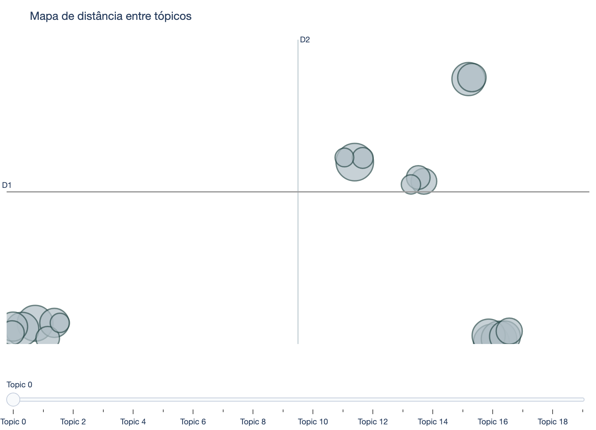
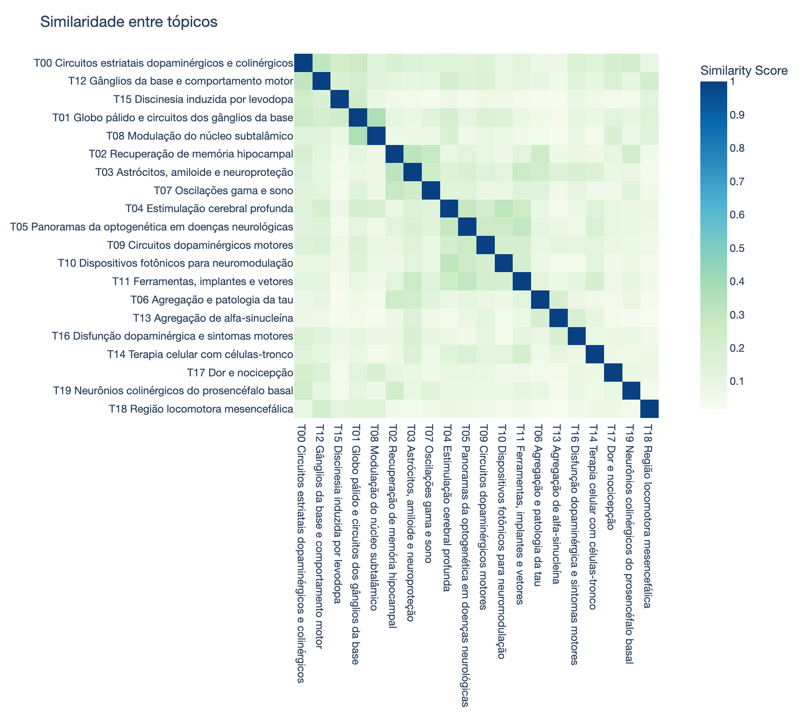

# Mapa de termos e tópicos

Gerado por `topicos/` a partir dos 801 trabalhos de `articles/`: 20 tópicos em 8 temas (BERTopic com minilm + umap + kmeans k=20) e 333 termos ligados por coocorrência. Não edite: a pasta é refeita a cada execução.

**Como ver:** abra a visão de grafo (Ctrl/Cmd+G). As cores são os temas; o filtro `path:"grafo/"` esconde as notas de artigos. Cada termo liga aos termos com que mais aparece junto (NPMI) e ao seu tópico dominante; cada tópico liga aos seus termos e trabalhos.

**Três grafos** (cole o filtro na busca da visão de grafo):

| Escopo | Filtro | Notas |
|---|---|---|
| Rede global de termos (esta pasta) | `path:"grafo/"` | `grafo/` |
| Os 801 artigos | `path:articles -path:grafo-selecionados` | `articles/grafo-todos/` |
| Os 370 da seleção final | `path:"articles/selected"` | `articles/selected/grafo-selecionados/` |

## Visualizações do BERTopic

Versões interativas: `data/topicos/viz/*.html` (abrem no navegador).

### Distância entre tópicos

### Hierarquia de tópicos

### Tópicos por ano

### Tópicos por doença citada

### Tópicos dentro e fora da seleção final

### Similaridade entre tópicos

## Tema 1 · motor, stn, dopamine (#3987e5)

- [[grafo/topicos/T00 Circuitos estriatais dopaminérgicos e colinérgicos|T00 Circuitos estriatais dopaminérgicos e colinérgicos]] · 68 trabalhos
- [[grafo/topicos/T01 Globo pálido e circuitos dos gânglios da base|T01 Globo pálido e circuitos dos gânglios da base]] · 62 trabalhos
- [[grafo/topicos/T08 Modulação do núcleo subtalâmico|T08 Modulação do núcleo subtalâmico]] · 41 trabalhos
- [[grafo/topicos/T12 Gânglios da base e comportamento motor|T12 Gânglios da base e comportamento motor]] · 32 trabalhos
- [[grafo/topicos/T15 Discinesia induzida por levodopa|T15 Discinesia induzida por levodopa]] · 27 trabalhos
- [[grafo/topicos/T16 Disfunção dopaminérgica e sintomas motores|T16 Disfunção dopaminérgica e sintomas motores]] · 21 trabalhos
- [[grafo/topicos/T18 Região locomotora mesencefálica|T18 Região locomotora mesencefálica]] · 18 trabalhos

## Tema 2 · memory, tau, synaptic (#d95926)

- [[grafo/topicos/T02 Recuperação de memória hipocampal|T02 Recuperação de memória hipocampal]] · 62 trabalhos
- [[grafo/topicos/T03 Astrócitos, amiloide e neuroproteção|T03 Astrócitos, amiloide e neuroproteção]] · 61 trabalhos
- [[grafo/topicos/T06 Agregação e patologia da tau|T06 Agregação e patologia da tau]] · 53 trabalhos
- [[grafo/topicos/T07 Oscilações gama e sono|T07 Oscilações gama e sono]] · 46 trabalhos

## Tema 3 · light, brain, neural (#199e70)

- [[grafo/topicos/T05 Panoramas da optogenética em doenças neurológicas|T05 Panoramas da optogenética em doenças neurológicas]] · 53 trabalhos
- [[grafo/topicos/T09 Circuitos dopaminérgicos motores|T09 Circuitos dopaminérgicos motores]] · 41 trabalhos
- [[grafo/topicos/T10 Dispositivos fotônicos para neuromodulação|T10 Dispositivos fotônicos para neuromodulação]] · 39 trabalhos
- [[grafo/topicos/T11 Ferramentas, implantes e vetores|T11 Ferramentas, implantes e vetores]] · 33 trabalhos

## Tema 4 · stimulation, dbs, brain (#c98500)

- [[grafo/topicos/T04 Estimulação cerebral profunda|T04 Estimulação cerebral profunda]] · 54 trabalhos

## Tema 5 · synuclein, aggregation, syn (#d55181)

- [[grafo/topicos/T13 Agregação de alfa-sinucleína|T13 Agregação de alfa-sinucleína]] · 28 trabalhos

## Tema 6 · stem, cells, cell (#008300)

- [[grafo/topicos/T14 Terapia celular com células-tronco|T14 Terapia celular com células-tronco]] · 27 trabalhos

## Tema 7 · pain, nociceptive, addiction (#9085e9)

- [[grafo/topicos/T17 Dor e nocicepção|T17 Dor e nocicepção]] · 18 trabalhos

## Tema 8 · cholinergic, cholinergic neurons, forebrain (#e66767)

- [[grafo/topicos/T19 Neurônios colinérgicos do prosencéfalo basal|T19 Neurônios colinérgicos do prosencéfalo basal]] · 17 trabalhos

